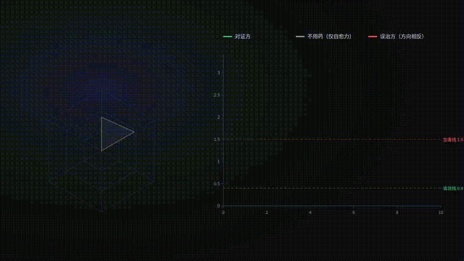

# TSIE — TCM State-Dynamics Inference Engine

> **Defensive publication.** First published 2026-11-17 (DOI [10.5281/zenodo.24296397](https://doi.org/10.5281/zenodo.24296397)).
> No patent is sought on the elements disclosed here; the intent is that nobody else can enclose them either.
> What is claimed, what prior art exists, and the exact disclosure locations are set out in [PRIORITY.md](PRIORITY.md) and §9 of the paper.

[](https://github.com/Even-li316/tcm-state-dynamics/actions/workflows/ci.yml)
[](LICENSE)
[](https://doi.org/10.5281/zenodo.24296397)

**Give it a syndrome state and a formula; it returns a state trajectory and an outcome class — not a paragraph of text.**

Most "AI + TCM" work today is text in, text out: an LLM writes a plausible-sounding prescription.
TSIE does something different and much smaller in scope: it keeps an explicit **state vector** over six
pathogenic axes (风 wind / 寒 cold / 暑 summer-heat / 湿 damp / 燥 dryness / 火 fire), applies a formula
as a **vector field with a release time-constant**, and integrates the state forward in time.

Because it is a dynamical system, it can answer questions a language model cannot: *does this state
converge, persist, or get worse — and when?*



## What this is / is not

| It **is** | It is **not** |
|---|---|
| A ~300-line, single-file, auditable dynamical model | A TCM large language model |
| A rollout: state → trajectory → outcome class | A knowledge graph or a formula search engine |
| Parameters written out in plain Python, every step traceable | A calibrated clinical predictor |
| A reference implementation to argue about | A medical device or a dosing tool |

## Paper

Preprint (6 pages): [doi:10.5281/zenodo.24296397](https://doi.org/10.5281/zenodo.24296397) · local copy [`paper/tsie_preprint.pdf`](paper/tsie_preprint.pdf) — *A Six-Axis State-Space Model of
Syndrome–Formula Dynamics in Traditional Chinese Medicine: Mechanism, Reference Implementation, and
Explicit Non-Claims*.

## Quick start

```bash
pip install -r requirements.txt

# 1) run the engine: writes out/*.png + out/summary.json
python engine/tcm_energy_sim.py

# 2) open the interactive demo (single file, no server, no build)
open demo/tcm_engine_demo.html
```

Python 3.9+, `numpy`, `matplotlib`. No GPU, no model weights, no downloads.

## The model in five lines

1. **State**: `E(t) ∈ R^6` — deviations on wind / cold / summer-heat / damp / dryness / fire; `|E|` is the
   degree of imbalance, zero = balanced.
2. **Herb → vector**: each herb's four-nature / five-flavour properties are mapped to a 6-axis vector by
   explicit rules (`drug_vector()`), scaled by a potency factor.
3. **Formula → net field**: weighted sum with classic roles 君 1.0 / 臣 0.6 / 佐 0.4 / 使 0.25.
4. **Dosage form = time constant**: 汤 decoction 1.0 / 散 powder 1.5 / 丹 3.0 / 丸 pill 4.0 / 膏 paste 6.0 —
   the classical dosage forms already encode a release rate.
5. **Dynamics**: `dE/dt = −k0·E + M·E + α·D_net·pulse(t)`, plus four gating rules:
   `R1` stop when the illness is gone (dose is gated by remaining illness), `R2` wrong treatment amplifies
   the pathogenic dynamic, `R3` cold-bitter herbs given to a cold-damp state aggravate it,
   `R4` pungent-warm herbs given to a blazing summer-heat/fire state add fuel.

Everything above lives in `engine/tcm_energy_sim.py` and can be read in one sitting.

## Demo results

Residual imbalance after 10 doses, normalised to the pre-treatment state (`1.0` = unchanged):

| Syndrome | Matched formula | No treatment | Wrong formula |
|---|---:|---:|---:|
| 风寒表实 (wind-cold, exterior excess) | **0.04** | 0.77 | 1.58 |
| 暑湿困脾 (summer-heat dampness) | **0.33** | 1.01 | 2.58 |
| 阴虚火旺 (yin deficiency, fire) | **0.01** | 1.34 | 3.32 |
| 寒厥·少阴 (cold reversal, lesser yin) | **0.07** | 0.88 | 2.19 |

The three arms separate cleanly. **That is a statement about internal consistency of the rules, not
about clinical validity** — see the next section.

Perturbing all five free constants by ±20% (lognormal, 300 draws, seed 20261117) preserves the ordering in
**90.7%** of draws, while the arbitrary `matched < 0.5` cut survives only 48.3% — the ordering is a property
of the rule structure, the threshold is not (`experiments/sensitivity.py`, Figure 3 of the paper).

## Honest limits (read before citing this)

- **Every coefficient is hand-set** from qualitative textbook rules (four natures, five flavours, channel
  entered, trend, pathogenesis transmission, dosage-form constants). None is fitted and none is measured.
- **All numbers are dimensionless** relative quantities. They are not µV, not mmHg, not a probability.
- **Coverage is deliberately tiny**: 6 axes, 43 herbs, 4 syndromes. This is a mechanism demonstration,
  not a materia medica.
- **The clean three-way separation is by construction.** The rules were written to produce it. A model that
  cannot be wrong is not evidence — which is why the roadmap below is about fitting and falsification.
- **Not a medical device.** No diagnosis, no prescription, no dose advice. Do not use it on patients.

## Contribute — this project is waiting for data, not code

The engine is done enough. What it cannot do without help is **collect a real course**: how long a state took
to resolve, under which intervention. If you have seen patients, taught cases, or read case collections, you
are the contributor this repository needs.

Four ways in. The two issue forms need no Git at all:

| Effort | Route | What it is for |
|---|---|---|
| 2 min | [Submit a case record](https://github.com/Even-li316/tcm-state-dynamics/issues/new?template=case_record.yml) | one episode: syndrome → formula → outcome |
| 2 min | [Submit an external-therapy operator](https://github.com/Even-li316/tcm-state-dynamics/issues/new?template=external_therapy.yml) | acupuncture / moxibustion / tuina: points, technique, frequency, duration, sessions |
| 10 min | Pull request with a JSON file under `contrib/` | a batch |
| open-ended | [Discussions](https://github.com/Even-li316/tcm-state-dynamics/discussions) | argue with the model, propose another mapping |

What is most valuable, in order:

1. **Case records that have an outcome** — resolved / improved / persisting / worsened, and how many visits.
   Without an outcome a record cannot falsify anything.
2. **External-therapy operators with a mapping.** The engine has *no* built-in mapping from "ST36, 2 Hz,
   20 min" to the six axes — supplying that mapping, with a source, is the contribution
   (`engine/external_therapy.py` is the contract, `contrib/external/` is where they live).
3. **Herb-table entries** — 43 today, each needs four-nature, five-flavour, channels, tendency, potency, source.
4. **Parameter fits** for `k0`, `M`, `α` — send the values and the script, not the data.

Hard rules, short version: de-identify at the source (no names, ID numbers, phone numbers, exact dates);
published cases need a citation; do not invent outcomes — `unknown` is a valid answer; do not submit
AI-generated cases. `tools/validate_contribution.py` enforces the schema and runs a privacy lint, and CI runs
it on every pull request. Full text: [CONTRIBUTING.md](CONTRIBUTING.md) · [中文](CONTRIBUTING.zh-CN.md).

## Repo layout

```
engine/tcm_energy_sim.py   the whole model + figure generation
engine/external_therapy.py operator contract for acupuncture / moxibustion / tuina
schema/                    JSON schemas for contributed case records and operators
contrib/                   contributed records (examples only, so far)
tools/validate_contribution.py  schema + privacy lint, run in CI
demo/tcm_engine_demo.html  interactive single-file demo (choose state → formula → watch trajectory)
figures/                   generated figures + this README's GIF
docs/model.md              equations, symbols, rule table
PRIORITY.md                defensive-publication statement (claimed elements, prior art, notice)
tests/smoke.py             one-command sanity check
experiments/sensitivity.py parameter-perturbation study
paper/tsie_preprint.pdf    preprint
out/                       engine output (generated on first run)
```

## Roadmap

1. **Fit the coefficients** to retrospective case series (`k0`, `M`, `α` from observed "how many visits
   until resolution") — until then the numbers stay dimensionless and the model stays a demo.
2. **Reverse mode**: give a target state, search the operator space for formula combinations; judge it by
   whether it recovers known formula–syndrome pairs.
3. **Extend the herb table** from 43 to a few hundred entries, each with a cited source.
4. **Add external-therapy operators** (acupuncture, moxibustion, tuina) as parametric inputs with physical
   units (frequency, intensity, duration) rather than qualitative labels.
5. **Falsification harness**: state in advance which case must fail, then run it.

## License

MIT. See `LICENSE`.

Contributions that make a coefficient *measurable* are worth more than contributions that add syndromes.
