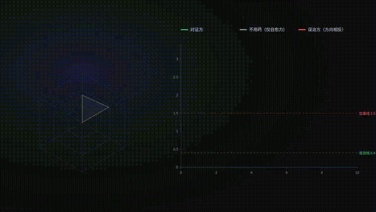

# TSIE · 中医状态动力学推演引擎

**输入「证候状态 ＋ 方剂」，输出「状态轨迹 ＋ 结局判定（收敛／迁延／加重）」——而不是一段文字。**

现在大多数「AI＋中医」是文本进、文本出：大模型写出一张看起来合理的方子。
TSIE 做的事小得多也具体得多：维护一个显式的**状态向量**（风／寒／暑／湿／燥／火 六维偏离量），
把方剂当作**带释放时间常数的向量场**施加上去，然后对时间做积分。

因为它是动力学系统，它能回答语言模型回答不了的问题：**这个状态会收敛、迁延，还是越治越重？多久？**



## 是什么 / 不是什么

| 是 | 不是 |
|---|---|
| 约 300 行、单文件、可逐行审计的动力学模型 | 中医大模型 |
| 一次 rollout：状态 → 轨迹 → 结局类别 | 知识图谱或方剂检索 |
| 参数全部写在代码里，每一步可溯源 | 经过标定的临床预测器 |
| 一个供人反驳的参考实现 | 医疗器械或剂量工具 |

## 快速开始

```bash
pip install -r requirements.txt
python engine/tcm_energy_sim.py          # 生成 out/*.png 与 out/summary.json
open demo/tcm_engine_demo.html           # 单文件交互演示，不起服务、不需构建
```

Python 3.9+、numpy、matplotlib。无 GPU、无权重、无下载。

## 模型五段

1. **状态**：`E(t) ∈ R^6`，六气偏离量；`|E|` 为失衡度，0 为平。
2. **药 → 向量**：四气五味／归经／趋向经显式规则映射为六维向量（`drug_vector()`），再乘药力系数。
3. **方 → 净向量**：按君臣佐使加权（君 1.0／臣 0.6／佐 0.4／使 0.25）。
4. **剂型 = 时间常数**：汤 1.0／散 1.5／丹 3.0／丸 4.0／膏 6.0 —— 古人已把释放速度编码进剂型。
5. **动力学**：`dE/dt = −k0·E + M·E + α·D_net·pulse(t)`，外加四条门控规则：
   `R1` 病去药止；`R2` 误治助邪（同向则传变×1.8、自愈×0.5）；`R3` 寒凉抑遏（里有寒湿而用大剂寒凉反增寒湿）；
   `R4` 暑火已盛而用辛温助热。

以上全部在 `engine/tcm_energy_sim.py` 里，一口气能读完。

## 演示结果

十剂之后残余失衡比（1.0 = 与治疗前持平）：

| 证候 | 对证方 | 不用药 | 误治方 |
|---|---:|---:|---:|
| 风寒表实 | **0.04** | 0.77 | 1.58 |
| 暑湿困脾 | **0.33** | 1.01 | 2.58 |
| 阴虚火旺 | **0.01** | 1.34 | 3.32 |
| 寒厥（少阴） | **0.07** | 0.88 | 2.19 |

三档分得很开。**这只说明规则内部自洽，不说明临床有效**——见下一节。

## 必须声明的边界

- **所有系数均为按中医定性规则手工设定**（四气五味／归经／趋向／病机传变／剂型常数），未拟合、未实测。
- **数值为无量纲相对量**，不是 µV、不是 mmHg、不是概率。
- **覆盖刻意很小**：6 个轴、43 味药、4 个证候。这是机制演示，不是本草库。
- **三档分明是规则写出来的结果**，本身不构成证据；不能错的模型不能证明任何事。
- **不是医疗器械**：不做诊断、不给方、不给剂量，请勿用于病人。

## 目录

```
engine/tcm_energy_sim.py   全部模型 + 出图
demo/tcm_engine_demo.html  单文件交互演示（选状态→选方→看轨迹）
figures/                   生成图与本 README 的动图
docs/model.md              方程、符号、规则表
tests/smoke.py             一条命令自检
out/                       运行后生成
```

## 路线

1. **把系数从「拍的」变成「拟合的」**：用回顾性病例序列反推 `k0 / M / α`（以"几诊而愈"为观测量）。在此之前数字只作演示。
2. **逆向模式**：给目标状态，搜索算子组合；判据是能否命中已知方证。
3. **药材表 43 → 数百味**，逐味标来源。
4. **外治算子**：针／灸／推拿按物理量（频率、强度、时长）入模型，而不是定性标签。
5. **可证伪清单**：事先写明哪种病案必须推演失败，再跑。

## 许可

MIT，见 `LICENSE`。

让某个系数**变得可测**的贡献，比再加十个证候有价值。
